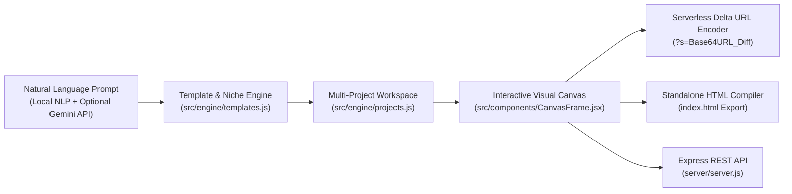

# مِعمار الصفحات — PageCraft Studio

<div align="center">

**An Editorial Prompt-to-Storefront & Interactive Landing Page Architecture Studio**  
*محرر معماري لبناء صفحات الهبوط والمتاجر التفاعلية المصغرة من الوصف النصي*

[](https://officialmosaleh.github.io/pagecraft-studio/)
[](https://react.dev/)
[](https://vite.dev/)
[](https://tailwindcss.com/)
[](https://vitest.dev/)

[**🔗 جرب النسخة الحية مباشرة (Live Demo)**](https://officialmosaleh.github.io/pagecraft-studio/)

</div>

---

## Overview | نبذة عن المشروع

**PageCraft Studio (مِعمار الصفحات)** is a full-scale Arabic-first visual landing page and interactive product catalog builder. Designed with an **Editorial Minimalist** philosophy (warm paper tones, hairline architectural borders, zero visual clutter), it transforms natural-language business descriptions into complete, multi-section websites with working shopping carts and itemized WhatsApp checkout.

تم تصميم **مِعمار الصفحات** ليكون أداة عملية حقيقية لأصحاب المشاريع والمصممين لبناء صفحات هبوط ومتاجر مصغرة كاملة التفاعل (كتالوج منتجات، سلة مشتريات، باقات أسعار، أسئلة شائعة، وإرسال الطلبات عبر واتساب) مع تحكم كامل في التخطيطات والألوان والخطوط العربية.

---

## Key Engineering Highlights | أبرز المميزات الهندسية

### 1. Serverless Delta-Compressed Shareable Links (`?s=...`)
- **Zero-Database Cloud Sharing:** Users can share their customized websites with clients anywhere in the world via a self-contained URL (`https://officialmosaleh.github.io/pagecraft-studio/?s=...`).
- **Delta Compression Engine (`src/engine/projects.js`):** Instead of serializing the entire 15KB state into the URL, the encoder computes a structural diff between the deterministic base template (`generatePageData(prompt, theme)`) and the user's modifications, encoding only the delta via UTF-8 Base64URL.

### 2. Multi-Layout Composable Section Pipeline & Drag-and-Drop Reordering
- **9 Modular Sections:** `Hero`, `Stats`, `Product Catalog`, `Quality Features`, `Process Steps`, `Pricing Tiers`, `Testimonials`, `FAQ Accordion`, and `WhatsApp Order Checkout`.
- **Multiple Architectural Variants per Section:**
  - **Hero:** `Editorial Classic` | `50/50 Split` | `Centered Panoramic`
  - **Catalog:** `3-Column Grid` | `Horizontal Detailed Menu` | `Featured Spotlight + Grid`
  - **Features:** `3 Numbered Columns` | `Editorial Horizontal Rows` | `Framed Cards`
  - **Stats, Process, Pricing, Testimonials:** Multiple layout variants switchable on the fly.
- **Dual Reordering UX:** Reorder sections via **HTML5 Drag-and-Drop** in the sidebar or directly via the **On-Canvas Floating Hover Toolbar**.

### 3. Dynamic Arabic Typography & Custom Brand Identity Engine
- **6 Curated Arabic Google Fonts:** Instant switching between `Cairo`, `Tajawal`, `IBM Plex Sans Arabic`, `Almarai`, `Readex Pro`, and `Amiri`.
- **Granular Font-Size Scaling:** 4 global presets (`Small`, `Medium`, `Large`, `Extra Large`) plus 5 independent pixel-level sliders (`Hero Headline`, `Section Titles`, `Card Titles`, `Body Text`, `Prices & Numbers`) powered by scoped CSS custom properties.
- **Custom Brand Color Pickers:** 4 base editorial themes (`Editorial Warm`, `Minimal White`, `Forest Organic`, `Charcoal Executive`), 6 curated brand swatches, and 4 live HTML5 color pickers (`Primary Accent`, `Page Background`, `Card Surface`, `Typography Color`).

### 4. True Responsive Container Simulation & Single-File HTML Compiler
- **Container-Isolated Mobile Viewport (`.pagecraft-mobile-mode`):** Accurately simulates a `375px` mobile viewport inside a desktop browser by overriding grid column spans, flex directions, and proportional font scaling.
- **Standalone HTML Compiler (`src/components/CodeExportModal.jsx`):** Compiles the entire customized page—including custom section order, active layout variants, typography scales, custom colors, and WhatsApp order logic—into a single, zero-dependency `index.html` file ready for instant hosting.

---

## System Architecture | الهيكلة المعمارية



---

## Tech Stack | التقنيات المستخدمة

| Layer | Technology |
| :--- | :--- |
| **Frontend Framework** | React 19 (Hooks, ContentEditable Inline Sync, HTML5 Drag & Drop) |
| **Build Tool & Bundler** | Vite 8 |
| **Styling & Design System** | Tailwind CSS v4 + Scoped CSS Custom Properties |
| **Backend API (Optional)** | Node.js + Express 5 (`server/server.js` — JSON persistence & `/p/:slug` SSR) |
| **Testing** | Vitest (Unit & Engine Tests in `src/engine/templates.test.js`) |

---

## Quick Start | طريقة التشغيل محلياً

```bash
# 1. Clone the repository
git clone https://github.com/OfficialMoSaleh/pagecraft-studio.git
cd pagecraft-studio

# 2. Install dependencies
npm install

# 3. Start the Vite development studio
npm run dev

# 4. (Optional) Start the Express persistence server on port 3001
npm run server

# 5. Run the unit test suite
npm test
```

### Server security settings | إعدادات أمان السيرفر

| Variable | Default | Purpose |
| :--- | :--- | :--- |
| `HOST` | `127.0.0.1` | Listen address. Use `0.0.0.0` only behind an HTTPS reverse proxy. |
| `PAGECRAFT_ADMIN_TOKEN` | — | Required (`Authorization: Bearer …`) for `POST`/`DELETE` from non-local requests. Without it, writes are accepted from localhost only. |
| `ALLOWED_ORIGINS` | — | Comma-separated CORS allow-list. Empty = same-origin only. |
| `PAGECRAFT_DATA_DIR` | `server/data` | Location of `pages.json` and `orders.json`; the last 20 versions of each are kept in `backups/`. |
| `TRUST_PROXY` | — | Set to `1` behind a reverse proxy so rate limits see real client IPs. |
| `TELEGRAM_BOT_TOKEN` / `TELEGRAM_CHAT_ID` | — | Optional: send every new order to the store owner on Telegram. |

Published pages at `/p/:slug` are rendered on the server from stored `pageData` (all text escaped, strict CSP). The server never stores or serves client-supplied HTML.

### Orders | الطلبات

When a store is published to the server, the storefront sends orders to `POST /api/sites/:slug/orders`:
- The total is **recomputed on the server** from the stored page (`src/engine/orderPricing.js`, shared with the storefront), so a tampered price is ignored.
- Order IDs are random (`ORD-XXXXXXXX`), not sequential.
- Customers track with `POST /api/orders/track` and must give **both** the order ID and their phone; the response never includes the address.
- The studio's orders inbox loads server orders (`GET /api/orders`, admin) and updates/deletes them on the server. When the studio talks to a remote server, store the admin token in the browser with `localStorage.setItem('pagecraft_admin_token', '…')`.
- Public order endpoints are rate-limited per IP.

Without the server (e.g. the GitHub Pages demo or `?s=` share links), orders fall back to the local demo inbox in the browser.

---

## Project Structure | هيكل الملفات

```text
pagecraft-studio/
├── src/
│   ├── engine/
│   │   ├── templates.js        # Niche detection, multi-layout definitions, fonts & brand palettes
│   │   ├── projects.js         # Multi-project workspace & Serverless Delta URL Encoder/Decoder
│   │   └── templates.test.js   # Vitest unit test suite
│   ├── components/
│   │   ├── CanvasFrame.jsx     # Interactive WYSIWYG canvas, cart logic & on-canvas section toolbar
│   │   ├── ProjectsModal.jsx   # Multi-project switcher, cloner & creator
│   │   ├── PublishModal.jsx    # Serverless cloud link generator & HTML downloader
│   │   ├── PublishedSiteView.jsx # Clean visitor-facing storefront renderer
│   │   ├── ImageEditorModal.jsx  # Local image uploader (Base64) & curated photo library
│   │   └── CodeExportModal.jsx   # Single-file standalone HTML compiler
│   └── App.jsx                 # Main studio workspace & 3-tab controller
└── server/
    └── server.js               # Express API for local project persistence
```

---

## License

MIT License — Built by [Mohamed Saleh (@OfficialMoSaleh)](https://github.com/OfficialMoSaleh).
