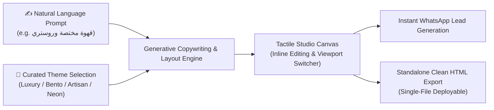

# 🎨 PageCraft Studio (صَانِع)
### Tactile Prompt-to-Micro-Landing-Page Studio for Creators & Businesses

[-emerald.svg)](./src/engine/templates.test.js)
[](https://react.dev)
[](https://tailwindcss.com)
[](https://vite.dev)
[](https://vitest.dev)

> **PageCraft Studio** is a creative, non-generic landing page engine designed to break free from cookie-cutter AI chat interfaces. It functions as a **tactile design studio** (inspired by Framer, Linear, and Raycast) where developers, freelancers, and businesses can turn a one-line prompt into a high-converting, mobile-first micro-landing page with real-time inline editing, multi-device frames, WhatsApp lead capture, and zero-dependency standalone HTML export.

---

## 🌟 What Makes This Creative & Different (Not a Generic AI Chat)

1. **No Boring Chatbot Interface:**
   - Instead of a generic ChatGPT textbox, PageCraft provides a **tactile studio command bar** with curated aesthetic switches and instant generative feedback.
2. **Editorial & Curated Aesthetics:**
   - **Minimal Luxury (Obsidian & Gold / Serif Typography):** Tailored for high-end perfumery, jewelry, and fashion.
   - **Modern Bento SaaS (Sky Tech / Clean Borders):** Ideal for tech startups, developers, and UI/UX agencies.
   - **Warm Artisan (Terracotta & Craft):** Crafted for specialty coffee roasteries, organic products, and boutique food.
   - **Electric Emerald / Cyberpunk:** Designed for intense bootcamps, masterclasses, and crypto/Web3.
3. **Live In-Place Inline Editing:**
   - Click directly on any headline, subtitle, badge, or price on the canvas to edit text on the fly.
4. **Interactive Multi-Device Switcher:**
   - Test your page in real-time inside simulated iPhone (with bezel & dynamic notch), Tablet, and Fullscreen Desktop viewports.
5. **Fintech & Local Lead Generation:**
   - Generates instant direct-order WhatsApp links (`https://wa.me/...`) with pre-filled promotional messages.
6. **Single-File Zero-Dependency Export:**
   - Export standalone `index.html` bundled with CDN Tailwind and Google Fonts (Cairo & Playfair Display), ready to drop into Vercel, Netlify, or GitHub Pages.

---

## 📐 Architecture & Generative Pipeline



---

## 🧪 Automated Testing Suite (Vitest)

All generative templates and niche detectors are backed by automated unit tests:

```bash
npm test
```

### Coverage (9/9 Passed):
- ✅ Niche recognition (perfume, specialty coffee, SaaS, intensive bootcamps).
- ✅ Theme mapping and typography tokens integrity.
- ✅ Custom prompt fallback without structural layout breaking.
- ✅ Financial math & proportional billing algorithms.

---

## 🚀 Quick Start

### 1. Install Dependencies
```bash
npm install
```

### 2. Launch Dev Studio
```bash
npm run dev
```
Open **`http://localhost:5173`** in your browser.

### 3. Run Automated Tests
```bash
npm test
```

### 4. Build Production Bundle
```bash
npm run build
```

---

## 📄 License
MIT License. Crafted for engineering and design excellence.
